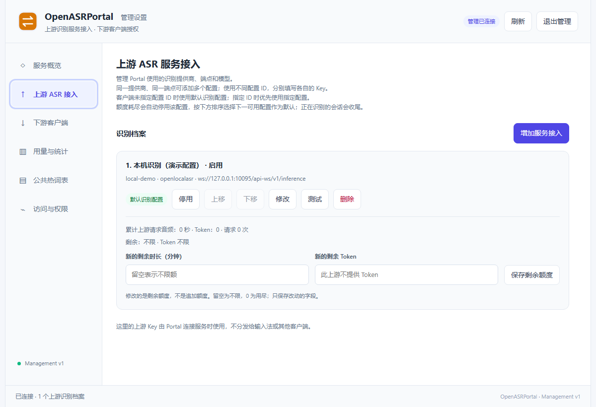
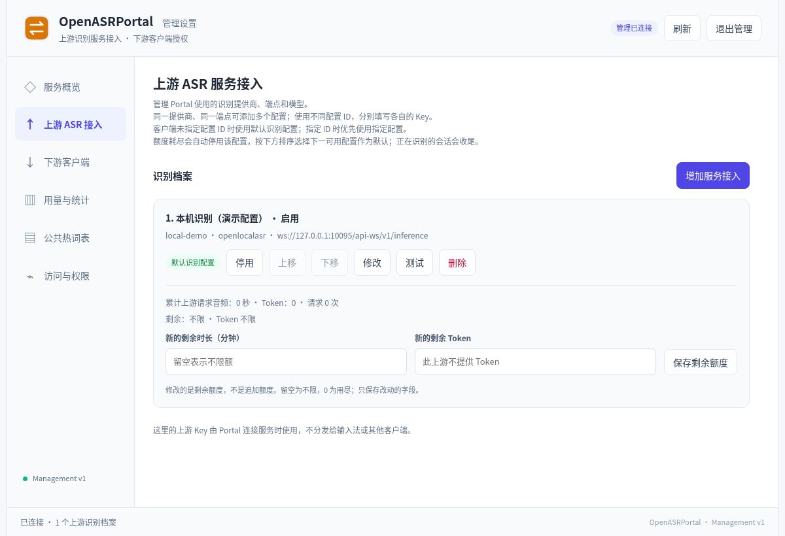

# OpenASRPortal user guide

**English** | [简体中文](user-guide.zh-CN.md)

Version **1.0.0**. For service installation, upstream configuration, and client administration. See [recognition API](API.md), [management protocol](MANAGEMENT.md), and [GPL v3](../LICENSE). English control descriptions below include important Chinese labels for the current UI.

## 1. Logical architecture

### 1.1 Portal's position

```text
Input / Notes / Drafts / custom clients
          │ Portal origin + client ASR key
          ▼
Portal: authentication → profile selection → sessions/metering → unified events
          │ upstream endpoint, model, provider key
          ▼
Doubao realtime / Bailian Qwen ASR / OpenLocalASR
```

Portal is a service, not a microphone recorder or text injector. It forwards client audio to recognition upstreams. A profile combines provider, endpoint, model, credentials, and options; one provider can have multiple distinct profile IDs.

Portal owns portal.db and its key vault. Notes, drafts, and model weights belong to Notes, Drafts, and LocalASR; their databases are not Portal's shared storage.

### 1.2 Three separate credentials

| Credential                         | Holder                        | Purpose                                                                      |
| ---------------------------------- | ----------------------------- | ---------------------------------------------------------------------------- |
| Admin password / short login token | Administrator                 | Profiles, client-key derivation/revocation, quotas, dictionaries, statistics |
| Client ASR key                     | Recording client/user         | Profiles, own sessions, personal hotwords                                    |
| Cloud-provider / LocalASR key      | Portal upstream configuration | Actual recognition engine; not distributed to ordinary clients               |

Admin passwords are not ASR keys; Notes login keys are unrelated. Admin logout revokes only that management session, not issued ASR keys.

### 1.3 Default and pinned profiles

Omitted profileId uses Portal default; explicit IDs pin profiles. Disabling/deleting/exhausting default selects the next available profile in order, **without migrating active recordings between models**. Pinned clients never silently fall back.

Input can follow default. Notes/Drafts 0.14.0 require explicit profile selection; “No configuration” disables voice. Changing only Portal default cannot remove this client difference.

## 2. Installation and configuration

### 2.1 Deployment choices

Windows normally uses native MSI service; Linux uses deb locally or Docker for container maintenance. Choose matching amd64/arm64 files; run one instance per port.

Native packages include private Python; images include service runtimes, but neither includes cloud accounts or LocalASR models. Verify SHA256SUMS with Linux `sha256sum -c SHA256SUMS` or Windows `Get-FileHash -Algorithm SHA256 <file>`, comparing matching entries.

### 2.2 Windows service installation

1. Run `OpenASRPortal_1.0.0_windows_amd64_native.msi` and authorize service installation.
2. Open http://127.0.0.1:10087/admin. If occupied, identify the existing instance before initializing the wrong service.
3. Complete password/upstream/client setup in §2.5.
4. Check OpenASRPortal in Windows Services. Closing the browser does not stop it.

Default data is `%ProgramData%\OpenASRPortal\data`; service configuration also lives under the product ProgramData directory. Program files/data are separate: copying Program Files alone is not a backup.



Windows 11 amd64 service extracted from 1.0.0 MSI, with temporary data/demo profiles. No real upstream recognition was performed; the image does not certify system service installation/upgrades/uninstallation.

### 2.3 Linux deb service

In the download directory, substituting ARM64 when needed:

```bash
sudo apt install ./OpenASRPortal_1.0.0_linux_amd64_local-service.deb
systemctl status openasrportal
curl http://127.0.0.1:10087/health
```

Open the same /admin URL. Data: /var/lib/openasrportal. Service listening/environment: /etc/openasrportal/service.env. Daily web administration needs no sudo; an administrator restarts openasrportal after environment changes.



Captured from version 1.0 source on Linux amd64, initialized with a demo LocalASR profile and hidden keys. It illustrates profiles/default/balances, not a real-model connection or new-version acceptance.

### 2.4 Linux Docker bundle

Extract `OpenASRPortal_1.0.0_linux_amd64_docker.tar.gz` for the appropriate architecture and enter its OpenASRPortal directory:

```bash
docker load -i image.tar
cp .env.example .env
mkdir -p data
sudo chown 10001:10001 data
docker compose up -d
docker compose ps
docker compose logs --tail 50 portal
```

For standalone Compose v2 use docker-compose. Defaults publish only host loopback. .env IMAGE selects the imported image; BIND/PORT control host listening; DATA selects persistence. UID 10001 must write a changed DATA directory. Docker Desktop uses host shared-directory permissions.

HTTP `docker compose down` preserves bind-mounted data/. If recreation shows initial setup, inspect changed directories/volumes before creating a second configuration.

### 2.5 Initial management and minimal recognition loop

1. First /admin on fresh data opens setup. Set/confirm a password of **at least 12 characters**; there is no preset Portal admin password.
2. Open Upstream ASR → Add Service (上游 ASR 接入 → 增加服务接入). For local LocalASR, use ID local-main, a descriptive title, provider OpenLocalASR, endpoint `ws://127.0.0.1:10095/api-ws/v1/inference`, actual active model name, and LocalASR's key.
3. Test Upstream Connection (测试上游连接), diagnose, then Save Connection (保存接入配置). The first profile becomes default; use Set Default when needed.
4. Under Downstream Clients (下游客户端), enter a name such as “Office Input,” Derive ASR Key (派生 ASR Key), and copy it.
5. Configure client Portal origin/key, select a usable profile, record a sentence, and await stable finals.
6. Query the matching interval under Usage and Statistics to confirm ownership.

Prepare LocalASR models first if not ready; Portal never downloads/switches its weights. A connection test differs from real microphone/end-to-end recognition. Step 3 alone is not a complete chain.

## 3. Management UI and operations

### 3.1 Layout, refresh, and saving

Six sidebar categories: Service Overview, Upstream ASR, Downstream Clients, Usage and Statistics, Public Hotword Tables, Access and Permissions. Top Refresh rereads server state; the bottom status bar reports results. After logout, sign in again with the password.

There is no global Save All. Profiles, quotas, public dictionaries, and personal hotwords have separate saves. Derive/revoke/disable/default/reorder submit immediately. Testing a draft does not save it. Save or discard before leaving a form; displayed values alone do not prove persistence.

### 3.2 Service overview

Shows profile count, valid key count, and upstream/downstream relationships. Confirm which Portal you accessed and whether resources exist. Counts do not establish enabled profiles, budget, or connectivity.

### 3.3 Common upstream fields

| Field / action             | Meaning                                                                                                                                          |
| -------------------------- | ------------------------------------------------------------------------------------------------------------------------------------------------ |
| Profile ID                 | Unique/immutable; starts alphanumeric, then letters/digits/dot/underscore/hyphen; ≤100 characters; used by pinned clients                        |
| Display name               | Editable human title; include purpose/account ownership                                                                                          |
| Provider                   | Selects fields/protocol; changing an endpoint alone cannot change protocols                                                                      |
| Upstream API key           | Required on creation; same-provider edits may leave blank when “saved, blank retains” is shown; provider changes require a new key; never echoed |
| Test upstream              | Tests draft/saved profile independently of saving; may incur requests/usage                                                                      |
| Save connection            | Persists; changes apply to future sessions                                                                                                       |
| Set default / move up/down | Selects new unpinned sessions and fallback order                                                                                                 |
| Disable / enable / delete  | Disable retains configuration; delete removes it; identify pinned clients first                                                                  |

### 3.4 Provider-specific configuration

**OpenLocalASR**

- Use a Portal-reachable ws:// or wss:// `/api-ws/v1/inference` endpoint.
- Current Server Model is the active name from LocalASR /v1/models, e.g. funasr_sensevoice_small, not its Chinese title.
- Key matches OPENLOCALASR_API_KEY. Update the profile after model changes.
- No token metering or session personal hotwords; use duration budgets.

**Doubao realtime ASR**

- Official WS endpoint is supplied/read-only.
- Enter the current service API key; choose an actually enabled model resource, including seedasr/bigasr duration/concurrent families.
- Second-pass recognition defaults on; later revisions can replace initial text. Compare accuracy/finalization delay before disabling.
- Multiple accounts use separate profiles, keys, order, and quotas.

**Bailian Qwen ASR Flash**

- Enter the DashScope HTTPS endpoint for the console workspace, allowing /api/v1 or the full recognition path; saving completes the path. **Do not use /compatible-mode/v1.**
- Current model is read-only qwen-audio-3.1-asr-flash. Follow the contract, not arbitrary chat-model names.
- Language can be automatic or explicit when known.
- Preview can be off or 1500/2500/4000 ms, default 2500. More frequent previews repeat HTTP recognition/audio usage, not merely screen updates.
- Silence segmentation: 600–3000 ms, default 1200. Shorter ends phrases earlier; longer tolerates pauses.
- Preserve Dialect defaults off; enable as needed, with model-dependent results.

### 3.5 Client keys: issue, reveal, revoke

Name keys by user or separately metered device. Give users Portal origin/key, not admin/provider credentials.

View / Copy (查看 / 复制) decrypt on demand. Hide/navigation/logout clear revealed page values, not the system clipboard. Legacy hash-only records cannot be reversed; recover reveal with the known original or derive a replacement.

**Revocation is irreversible** and cancels only that key's active/pending sessions. Rotate by issuing/updating clients first, then revoking old keys.

### 3.6 Quotas are new remaining balances

Both profile/client cards support remaining duration. UI units are **minutes**, converted internally to seconds. Upstreams with real token reports also allow token balances.

- Blank = unlimited; 0 = exhausted.
- Saving 60 means “60 minutes remain now,” not “add 60.”
- Either duration/token exhaustion blocks further recognition.
- Check enabled state too; replenishment does not override manual disablement.
- Actual tokens settle after requests; the last request may exceed balance. Missing reports are not zero. Do not apply token budgets to unmetered upstreams.

These are local Portal budgets, not cloud bills. Provider rounding, preview repeats, and final requests affect comparisons.

### 3.7 Usage and statistics

Set start/end, hour/day/month buckets, and all or specific client key/profile, then Query Statistics (查询统计). Last 7 Days restores a recent range.

The UI displays its query timezone (browser timezone), totals, trends, and both group details. Compare timezone/interval across devices. No independent timezone selector exists; automated management queries may specify one.

Downstream duration measures actual submitted PCM, not waiting. Upstream sums request audio, including HTTP re-recognition. Admin tests count upstream only. Failure/cancellation do not erase usage. Time queries cover whole-minute boundaries; quotas still debit by samples, not minute rounding.

### 3.8 Public hotword tables

1. Add Public Table (新增公共表): title, description, origin webpage, actual dictionary license/source notes; save generates ID.
2. Choose UTF-8 or paste text. TXT supports one term/line or term|weight; TSV, CSV, JSON, RIME .dict.yaml also work.
3. Parse / Preview Content (解析 / 预览正文), inspect report/count/search, fix encoding/columns/invalid terms.
4. Enable Publish to Client Catalog (发布到客户端推荐目录), then Save Public Table (保存公共表).
5. Clients still select individual terms and save personal lists; publication never forces all terms on users.

Limits: 4 MiB / 50000 valid terms/table, 100 tables. Split large dictionaries by domain. Online sources download into editable independent tables, not continuous repository synchronization. RIME data is parsed, not executed. PDFs/Sogou binary dictionaries cannot be parsed directly.

Updates/unpublishing/deletion leave saved personal words unchanged. Preserve third-party source/licenses rather than substituting project GPL.

### 3.9 Admin-managed personal lists and permissions

On a key card, Manage User Hotwords (管理用户热词表), add terms/weights 1–5, enable/disable individually, enable the master switch, then Save This Key's Hotwords (保存此 Key 的热词设置). Limit 2000; disabled terms persist; master-off pauses all.

Personal JSON merges by term, taking imported weight/state. Add public candidates individually and save. Client/admin edit the same revisioned list; refresh/merge conflicts. Use separate keys for separate spaces.

Access and Permissions shows current origin and management/recognition boundaries, without a listening-address control. Service environment/Compose controls binding. A displayed loopback address is not usable from another PC.

## 4. Advanced configuration and workflows

### 4.1 Remote HTTPS and container networking

Establish the local loop first. Docker's standalone compose.https.yaml publishes NGINX 80/443, keeps Portal inside the container network, and defaults to portal-data named volume.

1. Prepare nginx:1.28-alpine and a certificate covering actual DNS/IP.
2. Place tls/server.crt and tls/server.key. See [complete deployment instructions](../packaging/deployment/README.md) for generation/trust/rotation.
3. Start with `docker compose -f compose.https.yaml up -d`. **Do not stack it with compose.yaml.**
4. Set OPENASRPORTAL_HTTPS_BIND in .env to the intended interface before exposing access. Clients use the certificate-covered HTTPS origin directly.
5. Old HTTP data/ does not enter the new volume automatically. Stop/back up, change the HTTPS Portal mount to that directory, verify permissions, then start if retaining it.

Inside a container, 127.0.0.1 is that container. Use a LocalASR service name on the same network, or configured host.docker.internal for a host service listening on a reachable interface. Cross-Compose names require a shared network.

Clients need public certificates only; private keys stay server-side. Browser/Python/Node trust stores may differ. Proxies must forward WS Upgrade and permit streaming finalization.

### 4.2 Multiple upstreams and users

Create “daily cloud,” “local offline,” and “backup account” profiles, order them, and set default. Input needing fallback leaves profile ID empty; fixed-model devices specify IDs. Verify default changes with a new recording; active sessions retain snapshots.

Issue each user a key/budget and query usage separately. Same-key devices share hotwords/budget. Splitting one cloud account into profiles does not split the provider's budget; Portal only keeps independent local accounting.

### 4.3 Backup and migration

Stop service, then back up **the entire data directory/volume**, at minimum portal.db/asr-key-vault.key, plus deployment settings/certificates. Copying a live main DB can omit WAL; omitting the vault can prevent full-key reveal.

Stop the target, restore everything/ownership, start, and verify admin login, profiles, keys, hotwords, balances. Retain Docker project names or explicitly migrate volumes when moving deployment directories. down -v deletes volumes and is not ordinary shutdown.

### 4.4 Forgotten password and upgrades

Do not delete the database. Use interactive recovery on the actual data host:

```powershell
# Administrator PowerShell, default installation
& "$env:ProgramFiles/OpenASRPortal/python/python.exe" -B -m openasrportal.entrypoints.admin --data-dir "$env:ProgramData/OpenASRPortal/data"
```

```bash
sudo -u openasrportal /usr/bin/openasrportal --data-dir /var/lib/openasrportal --reset-admin-password
```

Source uses its own Python with `-m openasrportal.entrypoints.admin --data-dir <actual-directory>`. Recovery revokes management sessions while retaining profiles/ASR keys/business data. Never pass plaintext passwords as arguments.

Before upgrading, back up/end recognition. Afterward check health/login/upstream, then a client sentence. Standalone packages do not configure Input; combined MSI local handoff is separate. Uninstall retains data by default; delete only with explicit cleanup.

## 5. Frequently asked questions

### Health is OK; why does the client fail?

Health proves liveness only. Check key, existing/enabled profile, budget, upstream authentication/model. Start with the client error, then profile test. Management tokens are not ASR keys.

### Why is the key field blank after editing the address?

Secrets are not echoed. “Saved” indicates retained server value; same-provider omission preserves it, provider changes need a new value. New profiles never inherit another key.

### No upstream, or replenishment still fails?

Check positive balance, manual disablement, missing-report token blocks, and usable default order. Clients pinned to disabled IDs need a different selection; changing default alone cannot help.

### Why are upstream minutes greater than speaking time?

Bailian HTTP previews resubmit accumulated audio; admin tests count too. Distinguish downstream PCM, upstream request audio, and cloud billing. Compare with longer preview intervals or disabled previews.

### Why does publication not give users every hotword?

Public tables are recommendations. Users/admins select terms, save, and enable the personal list. Upstream limits still apply; LocalASR lacks session personal hotwords.

### Restored backup recognizes, but key reveal fails?

Authentication digests and encrypted originals are separate. Restore the matching vault; legacy hashes cannot be reversed. Recover with known originals or rotate replacement keys.

### Docker shows setup, 502, or unreachable addresses?

Setup: inspect DATA/volume/project name. 502: inspect health/NGINX logs. LocalASR failures: test reachability from Portal's container. Use each HTTP/HTTPS file's own -f and avoid mixed volumes/ports.

### Correct password is rejected?

Check origin/instance/session expiry; frequent attempts may throttle. Open the actual Portal /admin: local HTML or other-site cross-origin submissions are rejected.

Report deployment, ports, steps, error codes/requestId, removing passwords, keys, databases, and private keys. See [testing](testing.md) for real-recognition, service-installation, and HTTPS acceptance boundaries.
