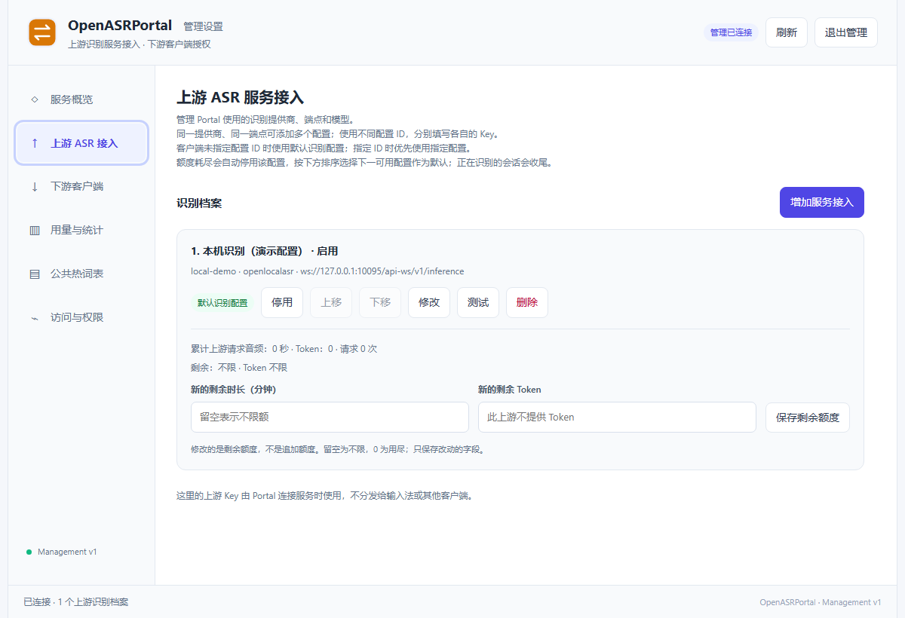
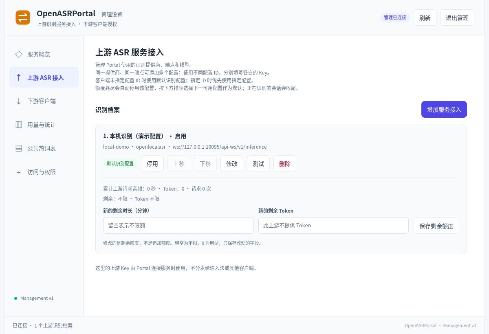

# OpenASRPortal 使用手册

[English](user-guide.md) | **简体中文**

## HTTP/HTTPS 代理

“测试代理”使用当前填写的设置，不会保存。可选择 HTTPS 测试目标（默认 `https://example.com/`）；面板显示是否可用及完整请求耗时，包含代理连接、TLS 和目标响应。成功只证明该目标可达，不代表所有 ASR 提供商可用。修改设置会清除显示结果；仅在代理地址相同时复用已保存认证。

原生安装包自带兼容的私有运行时；源码安装使用 HTTPS 代理需 Python 3.11+（HTTP 代理也支持 Python 3.10）。

在 Portal 管理页面打开 **Proxy 代理**，保存 `http://` 或 `https://` 代理地址。认证信息单独填写；勾选“更新代理认证”可替换凭据，同时留空可清除认证。已保存凭据加密存储且不回显。修改代理地址会清除旧认证，除非同时填写新凭据。

在每个上游档案中勾选“使用全局 Proxy 代理”并保存，所有提供商的连接测试和新识别连接均遵循此选择。代理不可用或未配置时直接报错，不会绕过代理；未勾选的档案直连。全局地址留空可移除代理；已建立的识别连接保持原路径。HTTPS 表示连接代理本身也使用 TLS，WSS 流量还会校验上游证书；私有代理证书应加入服务所在机器的受信任 CA 存储。

适用版本：**1.1.1**。本文面向安装服务、配置识别上游和管理客户端的用户。客户端开发见 [识别 API](API.zh-CN.md)，自动化管理见 [管理协议](MANAGEMENT.zh-CN.md)。项目采用 [GPL v3](../LICENSE)。

服务开通、API Key 获取及对应的 Portal 填写步骤分别见 [豆包语音 API 开通指南](doubao-api-setup.zh-CN.md)和 [阿里云百炼 API 开通指南](bailian-api-setup.zh-CN.md)。

## 1. 软件的逻辑架构

### 设置控件

管理页和首次设置页右上角使用 **中文 / English** 下拉框，切换语言保留未保存字段。刷新图标会重新加载页面，并返回当前分类。

每个上游以独立描边面板展示带标签的只读字段。“修改”解锁当前面板，“保存”应用更改，“取消”恢复已保存值；提供商固定字段和配置 ID 始终只读。密钥不回显，已有密钥留空时保留原值。“启用”开关即时生效，“使用全局 Proxy 代理”随档案编辑并保存。测试使用当前显示的配置（包括未保存的代理选择），在本面板内显示连接路径、结果和耗时。

新建 Soniox 档案默认英文、中文提示（`en,zh`）。百炼和 Boson 默认自动识别，包含英文、中文，也可选择单一语种。已有档案保留其保存的语言选择。

### 1.1 Portal 在系统中的位置

```text
Input / Notes / Drafts / 自有客户端
         │ Portal 地址 + 客户端 ASR Key
         ▼
Portal：鉴权 → 选择上游档案 → 会话与计量 → 统一识别事件
         │ 上游端点、模型与提供商 Key
         ▼
豆包实时 / 百炼 Qwen ASR / OpenLocalASR
```

Portal 是服务，不采集麦克风，也不向其他软件输入文字。客户端把音频发给它，它再调用识别上游。上游档案是“提供商、端点、模型、凭据和选项”的组合；一个提供商可有多张档案，以不同配置 ID 区分。

Portal 自己管理 `portal.db` 和 Key 保管文件。笔记、草稿和模型权重分别归 Notes、Drafts 和 LocalASR，不能把这些产品的数据库放进 Portal 当作统一存储。

### 1.2 三种凭据不要混用

| 凭据                           | 谁持有             | 用途                                             |
| ------------------------------ | ------------------ | ------------------------------------------------ |
| 管理密码及登录后短期管理 token | 管理员             | 管理档案、派生/撤销客户端 Key、配额、词表和统计  |
| 客户端 ASR Key                 | 录音客户端或使用者 | 获取识别档案、创建自己的会话、管理自己的个人热词 |
| 云提供商 / LocalASR Key        | Portal 上游配置    | Portal 连接实际识别引擎，不分发给普通客户端      |

管理密码不会成为客户端识别 Key；同一人的 Notes 登录密钥也与 Portal 无关。退出管理只撤销当前管理会话，不会撤销已派发的识别 Key。

### 1.3 默认档案与固定档案

客户端不指定 `profileId` 时采用 Portal 默认档案；指定 ID 时固定到对应档案。默认上游被停用、删除或额度用尽后，Portal 按排序选择下一可用档案；**不把正在进行的录音无缝迁移到另一模型**。固定档案的客户端也不会偷偷改用其他档案。

Input 可在界面选择跟随默认；Notes/Drafts 0.14.0 的界面需要显式选中一张档案，其“无配置”表示关闭语音。这一客户端差异不能通过只改 Portal 默认来消除。

## 2. 安装与配置

### 2.1 选择部署方式

Windows 常规使用原生 MSI 服务；Linux 单机可用 deb，需要容器化维护时选 Docker 镜像包。选择匹配的 amd64/arm64 文件，同一端口只运行一个实例。

原生包携带私有 Python；Docker 镜像携带服务运行环境。它们都不携带云账号或 LocalASR 模型。同时下载每个安装包的同名 `文件名.sha256`，每份只含该包的校验记录；Linux 使用 `sha256sum -c 文件名.sha256`，Windows 使用 `Get-FileHash -Algorithm SHA256 <文件>` 对照记录。

### 2.2 Windows：安装系统服务

1. 运行 `OpenASRPortal_1.1.1_windows_amd64.msi`，按向导授权安装服务。
2. 在浏览器打开 `http://127.0.0.1:10087/admin`。若端口已被占用，先确认是否已有 Portal 实例，避免初始化到错误服务。
3. 完成第 2.5 节的首次密码、上游和客户端设置。
4. 通过 Windows“服务”查看 OpenASRPortal 的运行状态。关闭浏览器不会停止服务。

当前源码默认数据在 `%ProgramData%\OpenASR\Portal\data`，服务配置 `service.json` 在其父目录。旧安装包使用 `%ProgramData%\OpenASRPortal`，迁移、合体包和语言选择见 [安装生命周期](installation.zh-CN.md)。备份时不要只复制 Program Files。



图为 Windows 11 amd64 中从 1.0.0 MSI 解包启动的真实服务，使用临时数据库和演示档案。图中上游没有进行真实识别；它不代表系统级服务安装、升级、卸载已经验收。

### 2.3 Linux：deb 服务

在下载目录执行，ARM64 替换为对应文件：

```bash
sudo apt install ./OpenASRPortal_1.1.1_linux_amd64.deb
systemctl status openasrportal
curl http://127.0.0.1:10087/health
```

浏览器访问同一 `/admin` 地址。当前源码数据在 `/var/lib/openasr/portal/data`，服务环境配置在 `/var/lib/openasr/portal/service.env`；旧默认 `/var/lib/openasrportal` 与 `/etc/openasrportal/service.env` 安装时迁移。日常网页管理不需要 sudo，修改服务环境后由管理员重启 `openasrportal`。



图为 Linux amd64 的 1.0 源码服务，已初始化并保存演示 LocalASR 档案，凭据未展开。它用于说明上游卡片、默认项和余额操作位置，不是连接真实模型的证明。

### 2.4 Linux：Docker 镜像包

解压对应架构的 `OpenASRPortal_1.1.1_linux_amd64.tar.gz`，进入包内 `OpenASRPortal` 目录：

```bash
docker load -i image.tar
cp .env.example .env
mkdir -p data
sudo chown 10001:10001 data
docker compose up -d
docker compose ps
docker compose logs --tail 50 portal
```

若安装的是独立 Compose v2 命令，将 `docker compose` 换成 `docker-compose`。默认仅将端口发布到宿主回环地址；`.env` 的 IMAGE 选导入镜像，BIND/PORT 控制宿主监听，DATA 选择持久目录。变更 DATA 后确认容器内 UID 10001 可写。Docker Desktop 的共享目录权限按宿主方式处理。

`docker compose down` 停止此 HTTP 方案并保留绑定的 data/。容器重建后重新出现首次设置页时，优先检查是否换了目录/卷，而不是立即再建一套配置。

### 2.5 首次管理与最小识别闭环

1. 新数据目录第一次打开 `/admin` 会进入首次设置。设置并确认**至少 12 字符**的管理密码；没有预设 Portal 管理密码。
2. 登录后进入 **上游 ASR 接入 → 增加服务接入**。以本机 LocalASR 为例：配置 ID 填 `local-main`，显示名称填“本机识别”，提供商选 OpenLocalASR，端点填 `ws://127.0.0.1:10095/api-ws/v1/inference`，模型填实际已激活的名称，上游 Key 填 LocalASR 的 Key。
3. 点 **测试上游连接**，根据结果排错，然后 **保存接入配置**。首个档案会成为默认；需要时在卡片点“设为默认”。
4. 进入 **下游客户端**，填写如“办公电脑 Input”的名称，点 **派生 ASR Key**，复制新 Key。
5. 在客户端填写 Portal origin 和刚创建的 Key，选择可用档案，录制一句短语并等待稳定定稿。
6. 回到 **用量与统计** 查询本次时间范围，确认调用归属符合预期。

LocalASR 未 ready 时先完成其模型准备；Portal 不代替它下载或切换权重。“连接测试”与真实麦克风、端到端识别是不同检查，不能只完成第三步就认为整条链路可用。

## 3. 管理页面与具体使用

### 3.1 页面布局、刷新和保存

侧栏有六类：服务概览、上游 ASR 接入、下游客户端、用量与统计、公共热词表、访问与权限。顶部“刷新”重新读取服务器状态，底部状态栏显示当前动作结果；退出后需要管理密码重新登录。

网页没有一个保存全部设置的总按钮。档案、额度、公共表和个人热词各有自己的保存按钮；派生、撤销、停用、默认和排序动作则直接提交。测试草稿配置不会自动保存。离开正在编辑的表单前先明确保存或放弃，不能以看见新值作为保存证据。

### 3.2 服务概览

概览显示上游档案数、有效客户端 Key 数和上下游关系。这里用于确认自己登录的是哪一套 Portal，以及是否已经配置必要资源。数量正常仍需检查档案状态、配额和实际连接。

### 3.3 上游 ASR 接入：通用字段

| 字段 / 操作         | 含义与使用方法                                                                                                |
| ------------------- | ------------------------------------------------------------------------------------------------------------- |
| 配置 ID             | 唯一且创建后不改；以字母或数字开头，可含字母、数字、点、下划线、短横线，最多 100 字符。客户端固定档案时使用它 |
| 显示名称            | 给人看的标题，可改名，建议包含用途或账号归属                                                                  |
| 提供商              | 决定下方显示哪些字段，不能只换端点就把一种协议变为另一种                                                      |
| 上游 API Key        | 新建必须填；同一提供商编辑时按“已保存、留空保留”提示操作，换提供商要提供新 Key。读取不会回显原值              |
| 测试上游连接        | 测试当前表单或保存档案；结果独立于保存，可能产生上游请求和用量                                                |
| 保存接入配置        | 持久化到 Portal；更改应用于后续新会话                                                                         |
| 设为默认 / 上下调整 | 决定未固定 ID 客户端的新会话选择以及默认失效后的候补顺序                                                      |
| 停用 / 启用 / 删除  | 停用保留档案便于恢复；删除移除配置。操作前确认哪些客户端固定了该 ID                                           |

### 3.4 提供商的具体配置

**OpenLocalASR**

- WebSocket 地址必须是 Portal 运行环境可达的 `/api-ws/v1/inference`，使用 `ws://` 或 `wss://`。
- “服务端当前模型”填 LocalASR `/v1/models` 中的 active 名称，如 `funasr_sensevoice_small`，不是中文显示标题。
- 上游 API Key 与 LocalASR 的 `OPENLOCALASR_API_KEY` 一致。改变模型后同步修改档案。
- 不提供 Token 计量与会话级个人热词；可用音频时长预算。

**豆包 · 实时语音识别**

- 官方 WebSocket 地址由程序提供，页面为只读。
- 填写当前服务所需 API Key；“模型资源”选择控制台实际开通的资源，选项包括 seedasr/bigasr 的 duration/concurrent 系列。
- “二遍识别”默认开启，后续修订可能替换首遍文字；关闭前先比较准确率和结束等待时间。
- 不同账号可保存多张档案，各自配置 Key、顺序和额度。

**百炼 · Qwen ASR Streaming**

- 填控制台对应业务空间的 DashScope WSS 地址，路径为 `/api-ws/v1/inference`，见[百炼开通](bailian-api-setup.zh-CN.md)。
- 当前模型字段为只读 `qwen-audio-3.1-asr-flash-streaming`；请授权这个完整型号。
- 识别语种可自动或指定；明确已知语种时可选对应项。
- 音频通过 WebSocket 上传一次，partial 直接来自模型。读取旧 HTTP 档案时自动迁移，保留 Key 和配额。
- 服务端断句静音范围 200–6000 ms，默认 800 ms；较短更早结束语段，较长容纳思考停顿。
- “保留方言表达”按需要开启，默认关闭。最终效果仍依赖上游模型。

**Boson AI · Higgs STT**

- 使用只读官方 WebSocket 地址、`higgs-stt-3.1` 模型及 Boson API key。
- 语种为 `auto` 或两位语言提示；断句静音为 600–3000 毫秒，默认 800 毫秒。
- 音频实时上传，停顿、达到 15 秒或停止录音时返回分段文本。没有逐字预览和会话热词，使用时长额度。
- 详见 [Boson 开通与协议行为](boson-api-setup.zh-CN.md)。

**Soniox · 实时语音识别**

- 固定 `stt-rt-v6` 模型及官方 WebSocket 地址，握手时用 API Key 鉴权。
- 语种为 `auto` 或两位提示代码；最大端点延迟 500–3000 ms，默认 2000。
- 真实 partial、语义端点定稿及上下文热词。使用音频时长配额；Soniox 云端另按连接时长计费。见 [Soniox 开通](soniox-api-setup.zh-CN.md)。

### 3.5 下游客户端：派发、查看、撤销

建议以使用者或需单独核算的设备命名 Key。派生后将 Portal origin 和 Key 一起交给使用者；没有必要交出管理密码和提供商 Key。

卡片中的 **查看 / 复制**按需解密完整 Key；隐藏、切页或退出管理会清除页面上展示的原值，但不替你清理系统剪贴板。旧版仅存哈希的记录无法反解；掌握原值时可恢复查看能力，否则派生替代 Key。

**撤销不可恢复**，同时取消该 Key 的活动和待连接会话，其他 Key 不受影响。轮换时先派生新 Key、更新需要继续使用的客户端，再撤销旧 Key。

### 3.6 额度：设置“新的剩余值”

上游卡和客户端卡都可设置剩余时长；界面单位为**分钟**，服务内部换成秒。支持真实 Token 上报的上游可再设 Token 余额。

- 空白表示不限额，`0` 表示已用尽。
- 输入 60 后保存表示“现在剩余 60 分钟”，不是在原余额上增加 60。
- 时长和 Token 同时限制时，任一个用尽即可阻止继续识别。
- 余额与启用状态需一起核对；补足额度后检查卡片是否仍手动停用。
- 累计 Token 按增量扣减并在任务结束结算，最终用量可能超过余额；未报告不能当作 0。缺少计量时不要用 Token 预算管理该上游。

配额是 Portal 本地预算，不能替代云控制台账单。云端取整和 Soniox 按连接时长计费都会影响两边数字。

### 3.7 用量与统计

设定开始/结束时间，选择按小时、天或月分组，再选全部或某个下游 Key、上游档案，点 **查询统计**；“最近 7 天”用于快速回到近期范围。

页面显示当前查询时区（按浏览器时区提交）、汇总、趋势和两类分组明细。核对跨设备数据时先核对时区与区间；界面没有独立时区选择器，自动化查询可按管理 API 指定。

下游时长按提交 PCM 计算，不按等待连接时间；上游音频只计一次，管理连接测试只计入上游。失败或取消不会抹去已用量。时间统计按整分钟覆盖边界，配额按样本扣减，不按分钟取整。

### 3.8 公共热词表

1. 点 **新增公共表**，填写名称、说明、来源网页和该词表的真实许可证/来源说明；ID 由保存生成。
2. 选 UTF-8 文件，或直接粘贴正文。TXT 可每行一词或 `词语|权重`，也支持 TSV、CSV、JSON、RIME `.dict.yaml`。
3. 点 **解析 / 预览正文**，看报告、有效词数和搜索结果。修正编码、列格式与无效词后再保存。
4. 需要客户端可见时勾选 **发布到客户端推荐目录**，点 **保存公共表**。
5. 客户端加载表后仍要逐词加入个人表并保存；发布不是强制给所有人启用。

每表最多 4 MiB / 50000 有效词，共最多 100 张表。大词库按行业或主题拆分。联网来源先下载到正文，再编辑保存为独立表；不是持续自动同步上游仓库。RIME 只解析词表，不执行其配置；PDF、搜狗二进制词库不能直接上传解析。

更新、停用或删除公共表不会改写用户已保存的个人词。下载第三方词库时保留来源与许可，不用项目 GPL 替代词库自身条款。

### 3.9 代管个人热词与访问权限

在某个 Key 卡点 **管理用户热词表**，新增词、设权重 1–5、逐词启用或停用，最后勾选总开关并 **保存此 Key 的热词设置**。最多 2000 词，停用保留条目，总开关关闭暂停全部词。

个人 JSON 导入按词语合并，同名词采用导入权重与状态；公共候选需逐词加入再保存。客户端和管理员编辑的是同一份表，遇到 revision 冲突先刷新再合并。需要独立热词空间就创建不同 Key。

“访问与权限”展示当前 Portal origin 与管理/识别边界，不提供更改监听地址的按钮；监听由安装服务环境或 Compose 控制。这里只展示当前访问地址，不能把回环地址直接发给另一台电脑使用。

## 4. 额外配置与复杂使用

### 4.1 远程 HTTPS 与容器网络

本机闭环成功后再配置远端访问。Docker 包提供独立 `compose.https.yaml`：NGINX 发布 80/443，Portal 仅在容器网络内监听，数据默认在 `portal-data` 命名卷。

1. 准备 `nginx:1.28-alpine` 镜像和覆盖实际 DNS 名/IP 的证书。
2. 证书放 `tls/server.crt`，私钥放 `tls/server.key`。自签名生成、信任和换证命令见 [完整部署操作](../packaging/deployment/README.zh-CN.md)。
3. 用 `docker compose -f compose.https.yaml up -d` 启动；它是独立方案，**不要与 compose.yaml 叠加**。
4. 对外开放前在 `.env` 设置 `OPENASRPORTAL_HTTPS_BIND` 为所需网卡地址；客户端直接填证书覆盖的 HTTPS origin。
5. 原 HTTP data/ 不会自动进入新命名卷。若继续用旧目录，先停止并备份，再将 HTTPS 配方的 Portal 挂载改为该目录，确认权限后启动。

Portal 在容器中时 `127.0.0.1` 是它自己。连接同一 Docker 网络的 LocalASR 使用服务名；连接主机可用配方中的 `host.docker.internal`，但主机 LocalASR 仍需监听容器可达接口。另一个 Compose 项目的服务名只有共享网络后才可解析。

客户端只需公有证书，私钥留在服务端。浏览器、Python、Node 信任库可能不同，分别验证。反向代理须转发 WebSocket Upgrade，并允许录音会话正常流式收尾。

### 4.2 多上游与多用户的实际配置例子

可建立“日常云识别”“本机离线”“备用账号”三张档案，排好顺序并选择默认。需要自动候补的 Input 使用空配置 ID；必须固定模型的设备填具体 ID。切换默认后用新一轮录音核对实际档案，正在进行的会话仍使用原快照。

每位使用者单独派生 Key，按需要分配时长，管理员在统计页分别查询。一个 Key 的多设备共用个人词和预算；同上游账号拆多张档案也不代表云端预算自动分开，Portal 只是本地独立记账。

### 4.3 数据备份与迁移

先停止服务，然后备份**整个数据目录/卷**，至少包含 `portal.db` 与 `asr-key-vault.key`，同时保存实际部署配置与证书。只复制使用中的数据库主文件可能遗漏 WAL；只带数据库而丢失保管文件会使部分完整 Key 无法查看。

恢复时停止目标实例，把完整备份放回对应目录并恢复服务用户权限，再启动检查管理登录、上游、客户端 Key、热词和余额。迁移 Docker 部署目录时保持 Compose 项目名或明确迁移卷，避免误创建空卷。`down -v` 会删除命名卷，不能当普通停止命令。

### 4.4 忘记管理密码与升级

不要删除数据库重设密码。在实际数据所在机器用产品恢复入口交互输入新密码：

```powershell
# 管理员 PowerShell；默认安装位置
& "$env:ProgramFiles/OpenASRPortal/python/python.exe" -B -m openasrportal.entrypoints.admin --data-dir "$env:ProgramData/OpenASR/Portal/data"
```

```bash
sudo -u openasrportal /usr/bin/openasrportal --data-dir /var/lib/openasr/portal/data --reset-admin-password
```

源码环境使用自身 Python 的 `-m openasrportal.entrypoints.admin --data-dir <实际目录>`。恢复撤销管理会话，保留档案、识别 Key 和业务数据；密码不作为命令行明文参数。

升级前备份并结束活动识别；升级后检查健康、登录、上游连接，再从客户端完成短句识别。独立包不自动配置 Input；联合 MSI 的本机授权交接属于单独安装方式。卸载默认保留数据，只有明确选择清理时再删除。

## 5. 常见问题与解答

### `/health` 正常，客户端为什么还失败？

它只说明 Portal 存活。检查客户端 Key、指定档案是否存在且启用、预算、上游认证及模型状态。先看客户端错误，再到上游卡测试，不要把管理 token 当 ASR Key 使用。

### 修改了地址，编辑框里的 Key 为什么是空的？

秘密不回显。已保存提示表示服务端仍有原值；同提供商省略 Key 可保留，换提供商必须给新值。新建档案不会继承另一张卡的 Key。

### 没有可用上游或补了额度仍失败？

核对新的剩余值是否大于零、卡片是否手动停用、Token 是否因未上报被阻断、默认顺序是否有可用项。固定停用 ID 的客户端需要改选档案；只改默认无效。

### 为什么上游分钟数比实际说话时间大？

管理连接测试只计上游。下游 PCM、上游上传音频和云平台账单需要分别比较。Soniox 按包含空闲的连接时长计费，Portal 统计音频；百炼 Token 是单个流式任务累计值，不跨事件相加。

### 公共表发布后，用户为什么没有自动获得全部词？

公共表只是推荐来源。用户或管理员需逐词加入该 Key 的个人表、保存并启用。热词仍受上游能力与上限影响，LocalASR 不使用会话级个人热词。

### 恢复备份后能识别，但“查看 Key”失败？

鉴权摘要与解密原值是不同数据。确认恢复了配套 `asr-key-vault.key`；旧版哈希记录不能反解。可用已知原值恢复查看能力，或派生新 Key 后轮换客户端。

### Docker 显示首次设置、502 或地址无法连接？

首次设置先查 DATA/卷/项目名；502 查 Portal 健康与 NGINX 日志；LocalASR 连接失败先从 Portal 所在容器核对地址可达性。HTTP 与 HTTPS 配方用各自的 `-f` 启停，不能混用卷和端口配置。

### 登录密码正确却被拒绝？

核对 origin、所连接实例和短期会话是否过期；频繁尝试可能触发限流。网页管理要求同源，请从实际 Portal 的 `/admin` 打开，不从本地下载 HTML 或其他站点跨源提交。

问题反馈提供部署方式、端口、操作步骤、错误码和 requestId，并移除密码、Key、数据库及私钥。真实识别、服务安装与 HTTPS 的验收边界见 [测试说明](testing.zh-CN.md)。
